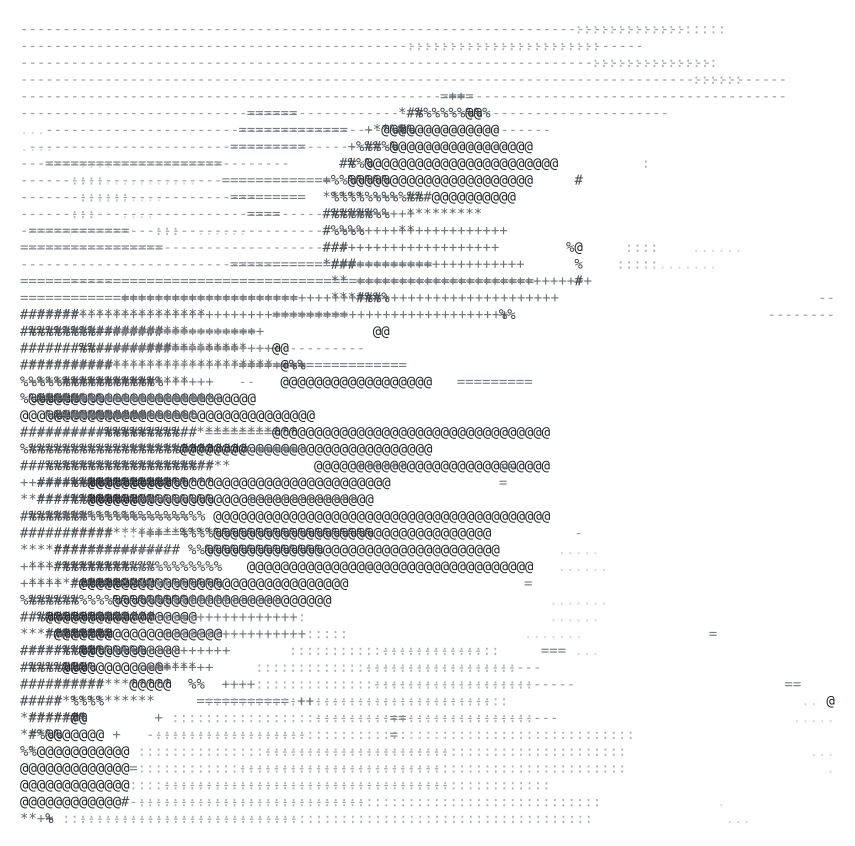

${\color{#2EA043}\texttt{noa@github}}\ {\color{#8B949E}\texttt{-------------------}}$  
${\color{#E36209}\texttt{OS:}}\ {\color{#8B949E}\texttt{.............}}\ {\color{#539BF5}\texttt{Windows 10}}$  
${\color{#E36209}\texttt{Host:}}\ {\color{#8B949E}\texttt{...........}}\ {\color{#539BF5}\texttt{M.Sc. in AI }\And\texttt{ ML}}$  
${\color{#E36209}\texttt{Kernel:}}\ {\color{#8B949E}\texttt{.........}}\ {\color{#539BF5}\texttt{AI/ML Engineer}}$  
${\color{#E36209}\texttt{IDE:}}\ {\color{#8B949E}\texttt{............}}\ {\color{#539BF5}\texttt{VS Code}}$  
&nbsp;  
${\color{#E36209}\texttt{Languages:}}\ {\color{#8B949E}\texttt{......}}\ {\color{#539BF5}\texttt{Python, SQL, C++}}$  
${\color{#E36209}\texttt{Frameworks:}}\ {\color{#8B949E}\texttt{.....}}\ {\color{#539BF5}\texttt{PyTorch, HF}}$  
${\color{#E36209}\texttt{Interests:}}\ {\color{#8B949E}\texttt{......}}\ {\color{#539BF5}\texttt{NNs}}$  
${\color{#E36209}\texttt{Learning:}}\ {\color{#8B949E}\texttt{.......}}\ {\color{#539BF5}\texttt{constantly}}$  
&nbsp;  
${\color{#2EA043}\texttt{- Contact}}\ {\color{#8B949E}\texttt{--------------------}}$  
${\color{#E36209}\texttt{LinkedIn:}}\ {\color{#8B949E}\texttt{.......}}$ [noa-car](https://www.linkedin.com/in/noa-car)  
&nbsp;

 
